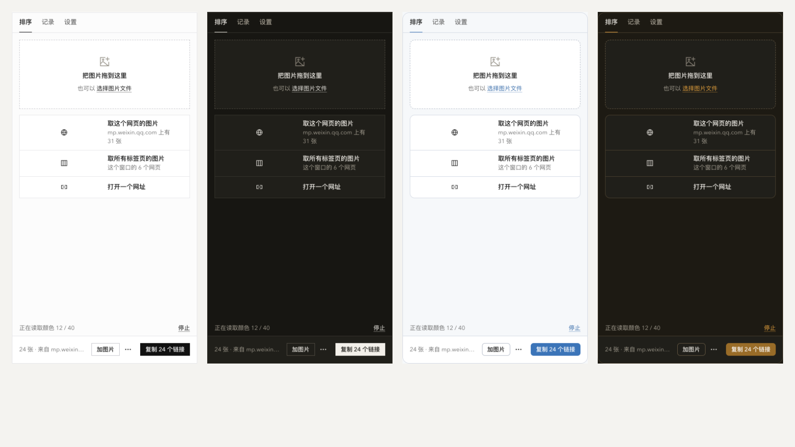

# xxd-ui-kit · XXD UI Kit

[中文](README.md) · **English**

[](https://github.com/nevertoday/xxd-ui-kit/actions/workflows/xxd.yml)
[](LICENSE)


A Chinese-first, framework-free UI kit: **one CSS file and one JS file**, with first-class support for Chrome extensions (MV3).
React projects can use it too (built on Cloudflare's [Kumo](https://github.com/cloudflare/kumo), restyled).

It is the design system of XXD (小小东), an independent maker: the XXD member site and XXD's Chrome extensions all use it, and the author makes the design calls. The code is open source under the [MIT License](LICENSE) — you're welcome to use it.

**Browse every component live: <https://ui.xiaoxiaodong.ai/en/>**



> **Status: alpha (0.x).** Not on npm yet — use it from source (shown below). During 0.x, minor versions may include breaking changes; see the [changelog](CHANGELOG.en.md).

## Good fit / not a good fit

**Good fit**

- Chrome extensions (MV3): component files are copied into the extension itself (extensions can't load remote code); UI injected into other people's pages is isolated in Shadow DOM; no flash on the first frame; Simplified Chinese, Traditional Chinese and English.
- Small sites and tool pages that don't want React or Tailwind: one `<link>` and one `<script>`.
- A quiet, restrained look: square corners by default, ink for emphasis, hairlines, system fonts, no web fonts.
- Something that keeps you honest: `xxd-ui doctor` checks for hard-coded colors, shadows, weights and radii, misspelt icon and class names, and extension manifests and locales.

**Not a good fit**

- Large admin panels, complex forms and data grids: [Ant Design](https://ant.design) is far more mature there.
- Copying component source into your project and restyling it: that's what [shadcn/ui](https://ui.shadcn.com) is for.
- Heavy brand customization: the look is opinionated (you can change the accent, corners and density, but it won't become a different style).

|  | xxd-ui-kit | shadcn/ui | Ant Design |
| --- | --- | --- | --- |
| Framework | None (native), React version too | React + Tailwind | React |
| How you use it | One CSS + one JS, or React components | Copy the source into your project | npm package |
| Chrome extensions | Built for it (vendor files, Shadow DOM, three languages, doctor) | No specific support | No specific support |
| Language | Chinese first, three languages | English | Chinese, English |
| Size | 59 components + 18 patterns | Many components, big community | The most complete |

## Quick start

### 0. Set up

You need Node 24.12 or later and pnpm 12 (if pnpm is missing, the version in `package.json` is downloaded automatically).

```bash
git clone https://github.com/nevertoday/xxd-ui-kit.git
cd xxd-ui-kit
pnpm install
pnpm xxd:build      # build tokens, icons, components, the extension kit and React (builds Kumo first the first time)
pnpm xxd link       # optional: install the global command xxd-ui so it works in any directory
```

Commands below are written as `xxd-ui …`; without `link`, run them inside the repo as `pnpm xxd …`.

### Plain web page

**Try it**: the showcase hosts versioned build files you can link directly:

```html
<script src="https://ui.xiaoxiaodong.ai/v/0.1.0/boot.js" data-key="my-site-ui"></script>
<link rel="stylesheet" href="https://ui.xiaoxiaodong.ai/v/0.1.0/xxd.css" />
<script src="https://ui.xiaoxiaodong.ai/v/0.1.0/icons.js"></script>
<script src="https://ui.xiaoxiaodong.ai/v/0.1.0/xxd.js"></script>

<body class="xxd-page">
  <button class="xxd-btn" data-variant="primary">Save</button>
</body>
```

**For real**: copy the files into your project and update them with one command:

```bash
xxd-ui init ./my-site     # writes xxd.config.json, copies the components, prints the lines for <head>
xxd-ui sync ./my-site     # later: copy in the latest version
```

**With a bundler (Vite etc.)**: pack `@xxd/css` with `xxd-ui pack` and install it (see the React section below), then:

```js
import "@xxd/css/dist/xxd.css";
import * as icons from "@xxd/icons";
import { install, uninstall, useIcons, toast, confirmDialog } from "@xxd/css";
useIcons(icons);  // turns <i data-xxd-icon="…"> into SVG (the classic script uses icons.js automatically)
install();        // or install(root, { signal }); uninstall(root) when that part of the page goes away
```

Icons, only the ones you use: `import { Check } from "@xxd/icons/each"`, then `iconSVG(Check)` or `<Icon icon={Check} />`. Names are typed (`IconName`), so typos show up in your editor.

Your site already has its own CSS variables and you don't want anything to change: see [bringing in an existing site](docs/en/existing-site.md).

### Chrome extension

```bash
xxd-ui new ./today --name "Today" --slug today
```

You get an extension you can load right away with “Load unpacked”: side panel, options page and three languages included. Add more when you need it:

| Option | Adds |
| --- | --- |
| `--popup` | The small window that opens from the toolbar icon |
| `--content "https://example.com/*"` | A content script that puts UI into web pages (isolated in Shadow DOM) |
| `--account` | Sign-in and membership pages (prices are placeholders) |

When the components are updated:

```bash
xxd-ui status          # which projects are behind (anything you've created, initialised or synced is remembered)
xxd-ui sync --all      # update all of them
xxd-ui doctor ./today  # check references, manifest, locales, MV3 rules and hard-coded styles
```

How to wire up pages, store appearance settings and put UI into web pages: see the [extension kit](docs/en/EXTENSION-KIT.md).

### React

```tsx
import { Button, Dialog, DialogActions, XxdAppearanceProvider } from "@xxd/react";
import "@xxd/react/standalone.css"; // without Tailwind
```

With Tailwind v4, put this at the very top of your CSS:

```css
@layer properties, theme, base, xxd, components, utilities;
@import "tailwindcss";
@import "@xxd/react/styles.css";
```

It's not on npm yet. To use it in a project outside the repo:

```bash
# in xxd-ui-kit: pack tokens, icons, css and react into four .tgz files
xxd-ui pack ./packs
# in your project
npm install ./packs/*.tgz
```

A complete example (an `App.tsx` with the providers) is on the showcase's [Getting started](https://ui.xiaoxiaodong.ai/en/start) page.

## Looking things up

```bash
xxd-ui ls               # every component
xxd-ui doc Dialog       # one component's markup, attributes and rules (Chinese names and typos work too)
xxd-ui doc Dialog --react
xxd-ui icon trash       # find an icon (500+ of them); add --svg / --react / --copy
xxd-ui tokens line      # tokens with their light / dark values
xxd-ui help --en        # every command
```

Or see [CLI and tools](https://ui.xiaoxiaodong.ai/en/tools) on the showcase. Every showcase page also has a `.md` version, plus `llms.txt` and a component registry endpoint for AI assistants.

## What's inside

Three layers, bottom to top; each uses the one below:

```
Tokens      colors, type sizes, spacing, radii              @xxd/tokens   @xxd/icons
  ↓
Components  native, framework-free                          @xxd/css
            React (Kumo, restyled)                          @xxd/react
  ↓
Extension   create extensions, sync components and          @xxd/extension
kit         settings, the CLI
```

| Package          | In one sentence                                                                                                       |
| ---------------- | --------------------------------------------------------------------------------------------------------------------- |
| `@xxd/tokens`    | The single source of every color, type size, spacing step and radius, plus a first-frame script so pages open in the user's theme |
| `@xxd/icons`     | 500+ icons drawn one way (24 grid, 1.5 stroke, square corners), searchable by Chinese keyword                         |
| `@xxd/css`       | 59 native components and 18 patterns (drag and drop, image viewer, two-step confirm, extension permission requests…); keyboard and screen-reader behavior is our own, checked by the audit |
| `@xxd/react`     | Kumo's React components in the XXD look (keyboard, focus and screen readers handled by Base UI underneath), plus XXD-only components and appearance and language providers |
| `@xxd/extension` | The Chrome extension toolkit and the `xxd-ui` command                                                                  |
| `@xxd/site`      | The showcase: every component, pattern, full-page template and design principle, in Chinese and English               |

## Development

```bash
pnpm xxd:build              # build every XXD package
pnpm xxd:test               # run every XXD test
pnpm --filter @cloudflare/kumo test   # also run this if you touched packages/kumo
pnpm lint
pnpm dev                    # the showcase at http://localhost:4400
```

Two checks before release (both need headless Chrome via `CHROME_EXE`):

```bash
pnpm --filter @xxd/site build
pnpm --filter @xxd/site visual   # screenshot diff: every page × 4 appearances
pnpm --filter @xxd/site run audit    # accessibility, long text, hostile host page, forced colors, untranslated text, polish, overlays, smoke, screen-reader walk-through
```

A few hard rules: no shadows on cards, rows or buttons; weights 400 / 500 / 600 only; animate only opacity and position; every visual decision traces back to the [design principles](https://ui.xiaoxiaodong.ai/en/principles).
How to contribute: [CONTRIBUTING](CONTRIBUTING.en.md).

## Docs

**Using it**

| You want to know          | Read                                                     |
| ------------------------- | -------------------------------------------------------- |
| Why it looks this way     | [Design principles](https://ui.xiaoxiaodong.ai/en/principles) |
| How to use it in an extension | [Extension kit](docs/en/EXTENSION-KIT.md)            |
| How to bring in an existing site | [Existing sites](docs/en/existing-site.md)         |
| What changed              | [Changelog](CHANGELOG.en.md)                              |
| Reporting a security issue | [Security](SECURITY.md)                                 |

**Maintaining it** (mostly in Chinese)

| You want to know                   | Read                                                     |
| ---------------------------------- | -------------------------------------------------------- |
| Roadmap and progress               | [Maintainer docs](docs/maintainers/) (plans, review, open-source checklist) |
| How the showcase is built and deployed | [Docs site](docs/DOCS-SITE.md)                        |
| Which Kumo variable maps to which  | [Token map](docs/token-map.md)                           |
| How to merge new Kumo versions     | [Syncing upstream](docs/UPSTREAM.md)                     |
| Engineering conventions for AI assistants | [AGENTS.md](AGENTS.md)                            |

## Kumo and Cloudflare

The React components come from Cloudflare's open-source component library [Kumo](https://github.com/cloudflare/kumo) (MIT), restyled in the XXD look; the native components, tokens, icons and extension kit are this project's own.
**This project is not affiliated with or endorsed by Cloudflare.** Cloudflare's brand components (logo etc.) are not exported from `@xxd/react`.

The repository keeps Kumo's commit history (so upstream can be merged), which is why Kumo's authors top GitHub's contributor list.
`packages/kumo*` is upstream code: its internal package name stays `@cloudflare/kumo` to keep merges easy — use `@xxd/react` instead. `pnpm kumo:dev` at the root opens Kumo's original docs site.

## License

MIT. XXD's parts are under [LICENSE](LICENSE); code from Kumo is MIT as well, with its original text in [LICENSE-KUMO](LICENSE-KUMO).
